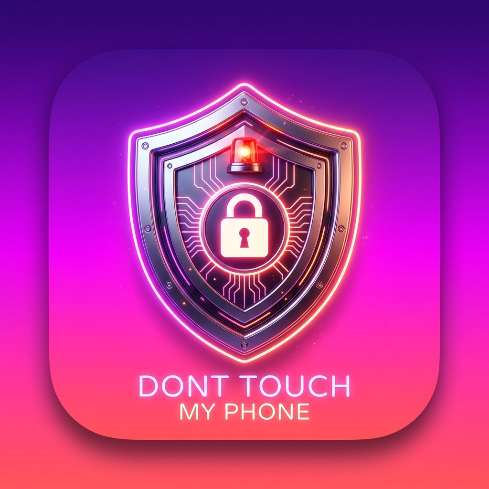

# Don't Touch My Phone: Antitheft 🛡️🚨

A production-quality mobile security alarm application for Android and iOS built with Flutter, Kotlin, and Swift.



---

## 🎨 Visual Design & Aesthetics

The application adheres strictly to modern security design principles:
- **Primary Color Palette:** Deep purple (`#6A1B9A`) fading to neon pink (`#AD1457`) and coral crimson (`#BF360C`).
- **Typography:** Bold white titles (Poppins / SF Pro) with high contrast and readable micro-copy.
- **Card Styling:** Smooth 20–28px rounded corners, elevated cards with subtle diffusion drop-shadows.
- **Micro-Animations:** Interactive state transformations, pulsing shield radar animations, and haptic feedback.
- **Tone:** Friendly, authoritative cybersecurity protection.

---

## 🚀 Key Features

### 1. 📳 Motion Alarm (Accelerometer-based)
- Uses real device accelerometer sensors via calibrated vector magnitude calculations:
  $$\Delta M = \sqrt{x^2 + y^2 + z^2} - 9.81$$
- Configurable sensitivity thresholds:
  - **Low:** 3.5 m/s² (firm movement)
  - **Medium:** 2.0 m/s² (gentle pick up)
  - **High:** 1.0 m/s² (slight tilt or touch)
- Arming countdown delay (1–10 seconds) allowing user to set down device securely before arming.

### 2. 📸 Break-In / Wrong PIN Intruder Alert
- Tracks incorrect PIN attempts.
- Escalates to high-decibel alarm after customizable threshold (e.g., 3 attempts).
- **Silent Intruder Selfie Capture:**
  - **Android:** Uses native `Camera2` API targeting `LENS_FACING_FRONT` to silently capture intruder photos upon breach.
  - **iOS:** Uses native `AVCaptureSession` and `AVCapturePhotoOutput` with front-facing camera.
- Photos are tagged with timestamps and stored in private app storage for security audits.

### 3. ✈️ Airplane Mode / Network Loss Alarm
- Uses `connectivity_plus` and native reachability listeners (`NWPathMonitor` on iOS, `Settings.Global.AIRPLANE_MODE_ON` on Android).
- Immediate alert if unauthorized party toggles Airplane mode or turns off mobile data/WiFi.

### 4. ⚡ Charger Connected / Disconnect & Full Battery Alarm
- Detects charger plug-in and sudden charger disconnection.
- Monitors battery percentage and notifies when user-configured threshold (e.g., 80% or 100%) is achieved.

### 5. 💡 Hardware Flashlight Strobe
- **Android:** Real camera torch via `CameraManager.setTorchMode()`.
- **iOS:** Real torch via `AVCaptureDevice.setTorchModeOn()`.
- Supports 3 strobe frequencies: Slow (800ms), Fast (200ms), Continuous (100ms).

### 6. 📳 Haptic Vibration Sequences
- Multi-cadence hardware vibration patterns:
  - **Light:** Short warning pulses (300ms)
  - **Medium:** Pulsing cadence (500ms)
  - **Strong:** Aggressive continuous pulse cycles (1000ms)

### 7. 🔊 8 Authentic Siren Sounds
Synthesized acoustic audio waveforms bundled in `assets/sounds/`:
1. `police_siren`: Frequency sweep from 600 Hz to 1400 Hz
2. `emergency_siren`: Alternating European hi-lo dual-tone
3. `car_alarm`: Cycling alarm bursts with horn pulses
4. `loud_beep`: High-frequency staccato pulses
5. `warning`: Dual-tone urgency harmonic
6. `funny_alarm`: Comic slide whistle
7. `scary_alarm`: Minor-second dissonance with tremolo
8. `screaming_alarm`: High-frequency modulation screech

### 8. 🔐 PIN Passcode & Secure Storage
- 4-digit or 6-digit numeric PIN pad with custom animated keypad.
- SHA-256 salted cryptographic hashing.
- Encrypted storage via `flutter_secure_storage`:
  - **Android:** EncryptedSharedPreferences (Hardware KeyStore).
  - **iOS:** Keychain with `kSecAttrAccessibleAfterFirstUnlockThisDeviceOnly`.

---

## 🛠️ Architecture & Tech Stack

```
lib/
├── core/
│   ├── constants/        # App constants, channel names, sound definitions
│   ├── services/         # AlarmEngine (sound/flash/vibe), MotionService
│   ├── theme/            # AppTheme, colors, typography, gradients
│   └── utils/            # HashUtils, DateTimeUtils, SensitivityUtils
├── data/
│   ├── local/            # LocalStorageService (Hive, SharedPreferences, SecureStorage)
│   └── repositories/     # ProtectionRepository, SettingsRepository
├── features/
│   ├── airplane_alarm/   # Airplane alarm settings and network monitor
│   ├── alarm/            # Active full-screen alarm screen with PIN override
│   ├── alarm_history/    # Detailed event timeline with audit logs
│   ├── break_in/         # Intrusion attempt viewer & break-in alert
│   ├── charging_alarm/   # Battery & charging monitor screen
│   ├── home/             # Main dashboard with animated shield & quick switches
│   ├── motion_alarm/     # Sensitivity tuning, countdown, motion testing
│   ├── onboarding/       # 3-step feature onboarding walkthrough
│   ├── passcode/         # Create PIN & Verify PIN interactive keypads
│   ├── security/         # Security dashboard with all protection modules
│   ├── settings/         # Full app settings, sound selector, strobe controls
│   └── splash/           # Animated splash screen with elastic shield
├── models/               # AppSettings, ProtectionState, AlarmEvent (Hive)
├── navigation/           # GoRouter declarative routing system
└── widgets/              # MainScaffold with bottom navigation
```

### Native Implementations

| Feature | Android (Kotlin) | iOS (Swift) |
|---|---|---|
| MethodChannel | `com.security.antitheft.dont_touch_my_phone/native_security` | Same |
| Flashlight | `CameraManager.setTorchMode` | `AVCaptureDevice.setTorchModeOn` |
| System Tone | `ToneGenerator` + `RingtoneManager` | `AudioServicesPlayAlertSound` |
| Intruder Photo | `Camera2` (`LENS_FACING_FRONT`) | `AVCaptureSession` (Front Camera) |
| Battery State | `BatteryManager` | `UIDevice.batteryState` |
| Airplane Status | `Settings.Global.AIRPLANE_MODE_ON` | `NWPathMonitor` |

---

## 🧪 Testing

Run unit tests:
```bash
flutter test
```

Tests cover:
- `HashUtils`: Cryptographic salt verification and mismatch checks
- `SensitivityUtils`: Threshold-to-category mappings
- `DateTimeUtils`: Formatting and human-readable relative time
- `ProtectionState`: State machine transitions and display names
- `AppSettings`: Default values and immutability via `copyWith`
- `AlarmEvent`: Hive event serialization and categorization

---

## 📲 Building & Running

### Prerequisites
- Flutter SDK 3.0.0+
- Android Studio / Xcode 15+

### Installation
```bash
# 1. Fetch dependencies
flutter pub get

# 2. Run on connected Android or iOS device
flutter run
```
